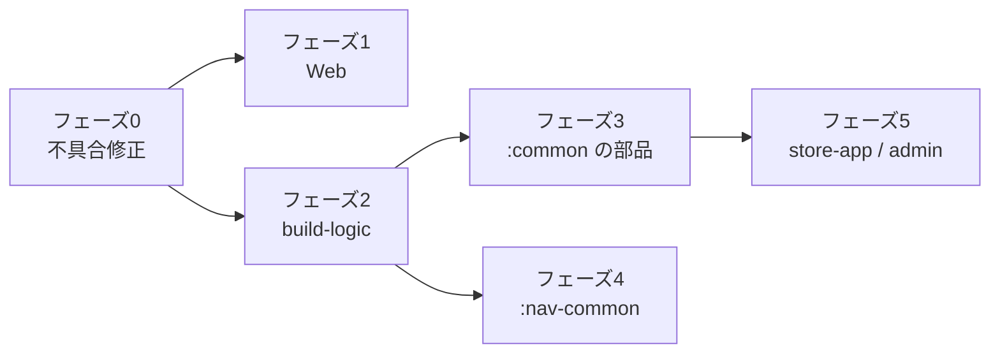

# appstore リファクタリング計画

調査範囲: `web/`(Next.js)・`workers/scan/`・`supabase/`・`.github/`・`store-app/`・`native-apps/`(60モジュール、Kotlin 約38,000行)

作成: 2026-10-22 / 状態: **未着手(着手前の確認待ち)**

> [!CAUTION]
> **この計画を実行する人(AIエージェントを含む)へ**: 作業を始める前に、末尾の「着手前に決めておくべき事項」を必ず持ち主に確認し、了承を得ること。確認が済むまで、コードの変更を始めないこと。

> [!IMPORTANT]
> 調査中に、リファクタではなく**不具合**と言えるものが見つかりました(フェーズ0)。リファクタより先に直すことをおすすめします。

---

## フェーズ0: 不具合・セキュリティ修正(最優先・小規模)

| # | 内容 | 場所 | 影響 |
|---|---|---|---|
| 0-1 | **メールアドレス検証の正規表現が壊れている**。`/^[^s@]+@[^s@]+.[^s@]+$/` は `\s` ではなく「文字 s」を禁止しているため、**`s` を含むアドレス宛のメールが全部失敗する** | [mail.ts:36](../web/src/lib/mail.ts#L36) | 開発者への審査結果メールが届かない |
| 0-2 | proxy の matcher が `/dev/:path*` になっており、`/developer/*` でセッションが更新されない | [proxy.ts:28](../web/src/proxy.ts#L28) | 開発者ポータルで意図せずログアウトされる |
| 0-3 | **オープンリダイレクト**: `next` を検証せず `${origin}${next}` に連結している(`next=@evil.com` → 外部ホストへ)。ログイン画面の `router.replace(next)` も同じ | [auth/callback/route.ts](../web/src/app/auth/callback/route.ts)、`login/page.tsx`、`admin/login/page.tsx` | フィッシングに悪用されうる |
| 0-4 | ストアアプリの認証トークンが**平文の SharedPreferences** に保存されている(コメントでも課題として認識済み)。管理アプリには `KeystoreSessionStore` がすでにある | [AuthSession.kt](../store-app/app/src/main/java/com/kawamonn/store/auth/AuthSession.kt) / [KeystoreSessionStore.kt](../native-apps/ttech-admin/src/main/java/com/ttech/admin/data/KeystoreSessionStore.kt) | トークンの漏えいリスク |
| 0-5 | **データ消失リスク**: 37個のアプリの保存処理が「JSONの読み込みに失敗したら空リスト」を返す。モデルの変更などで読めなくなると、**次に保存したときに全データが空で上書きされる** | 例: [EventStore.kt](../native-apps/attendance-count/src/main/java/com/ttech/attendancecount/data/EventStore.kt)、[BabyEventStore.kt](../native-apps/baby-log/src/main/java/com/ttech/babylog/data/BabyEventStore.kt) | 利用者の記録が消える |
| 0-6 | 管理コンソールからのリリース承認(`ReleaseManager.tsx` → `setReleaseStatus`)が `reviewRelease` を通らない。`reviewed_by/at` 未記録・開発者へのメールなし・監査ログなし。審査で見つかった点(`policy_findings`)も画面に出ない | `admin/(console)/actions.ts`、`ReleaseManager.tsx` | 運用ミスに気づけない |
| 0-7 | アカウント削除で `diary-media/{userId}/` の写真が残る。管理画面のメディア差し替え・アプリ削除でも古いファイルが残る | `api/account/delete/route.ts`、`actions.ts` | ストレージのゴミ・個人データの残存 |
| 0-8 | `privacy.html` が存在しない `privacy-policy.html` にリンクしている(404) | [privacy.html:28](../web/public/policies/privacy.html#L28) | リンク切れ |

0-5 の直し方: 読み込みに失敗したら空にせず、元のJSONを退避してから例外として扱う(上書きしない)。フェーズ2の共通ストアにまとめて入れられます。

---

## フェーズ1: Web(`web/`)

### 1-1. 管理コンソールと開発者ポータルの処理をまとめる(効果:大)
アプリの作成・編集、メディア、リリースのアップロードが**2系統で別々に実装されて**おり、すでに動きが食い違っています。

| 処理 | 管理者 | 開発者 |
|---|---|---|
| 画像 | ブラウザから直接アップロード(検証・EXIF除去・古いファイルの削除なし) | `processImage` で検証・変換して古いファイルを削除 |
| APK | `apk/` に直接 | `upload/` に置いてからサーバー側で複製(すり替え対策あり) |
| 短い説明の上限 | 80文字 | 200文字(DB制約も200) |
| リリースノートの上限 / APKサイズの上限 | 4000 / 1GiB | 2000 / 500MiB |

→ 管理者もすでに開発者として登録されている(`ensureAdminDeveloper`)ので、**開発者側の処理(`lib/developer.ts`・`/api/developer/*`)を共通の処理として管理者も使う**形にします。管理者だけの違い(手動承認・制限なし)は引数で切り替えます。

### 1-2. API ルートの共通化
- エラーの形式が `{ error: { code, message } }`(`http.ts`)と `{ error: "文字列" }`(`/api/developer/*` など)の2種類 → 1つに統一
- UUIDの検証方法が3通り(`z.string().uuid()`、正規表現 `/^[0-9a-f-]{36}$/`、検証なし → 不正なIDで500になる) → `IdParam` に統一
- `requireAdmin` と `adminOr401` は同じ関数 → 1つに

### 1-3. 重複している小さな処理を `lib/` に集める
- `first()`(Supabase の関連の取り出し): 2か所で定義、11か所で同じ処理を直接書いている
- `displayNames`(2か所)、`CONTROL_CHARS`(2か所)、バイト数の表示(3か所)、進捗つきPUT(2か所)
- アプリの状態ラベル(4か所。`draft` が「非公開」と「下書き」で食い違い)
- `suggestSlug`(3か所。動きがそれぞれ違う)
- `getAppBySlug` / `getAppByPackage`(条件だけ違う)
- `sendAdminMail` は `sendMailTo` を呼ぶだけにする
- `account/page.tsx` の承認待ちリリースの取得 → 既存の `listPendingReleases` を使う

### 1-4. スクリプト(`web/scripts/`)
- `publish-app.mjs`・`upload-tool.mjs` が、共通化済みの `scripts/lib/cli-env.mjs` を使わず同じ処理を書いている
- `class R2` が2つのスクリプトにコピーされている → `scripts/lib/` に移す
- `decideScan` が `lib/scan.ts` と `publish-app.mjs` にコピーされており、**スクリプト側は審査ルール(`evaluatePolicy`)を通らない** → 1つにまとめる
- `set-app-icon.mjs` と `add-screenshot.mjs` はほぼ同じ(スクショ側は画像の検証なし) → 統合

### 1-5. パフォーマンス
トップページで件数の多い集計(`count: "exact"`)を3回実行している([page.tsx:17](../web/src/app/page.tsx#L17) と `getHome`)。→ `getHome` から `total` を返して1回にする。

### 1-6. 使われていないコード・設定の削除
- `getAdminMfaStatus`(テストからしか使われていない)
- 開発者の「申請(pending)」の通知の流れ一式(登録が自動承認になってから使われていない): `notify.ts` の該当部分、DBトリガー `trg_notify_developer`、RLSポリシー `developers_apply`
- `web/.vercel/`(PM2 + Cloudflare Tunnel に移行済み)、`public/` にある Next.js 標準の SVG
- `diary_entries_set_updated_at()`(`touch_updated_at()` と同じ内容)→ 新しいマイグレーションで置き換え

---

## フェーズ2: Android のビルド構成(`native-apps/`)

### 2-1. Gradle の Convention Plugin(`build-logic/`)を導入する(効果:大)
- `build.gradle.kts` は**60ファイル・合計5,054行**。`compileSdk 37 / minSdk 26 / targetSdk 36`、署名設定(60個すべてで同じ `keystore.properties` の読み込み)、リリースビルドの設定、Compose の依存がすべてコピーです。
- `build-logic/` に `ttech.android.app` などのプラグインを作り、各アプリは次の程度にします:

```kotlin
plugins { id("ttech.android.app") }
android {
    namespace = "com.ttech.attendancecount"
    defaultConfig { applicationId = namespace; versionCode = 2; versionName = "1.0.1" }
}
```

  → 1アプリ80行前後 → 10行前後。SDK のバージョンを上げるときも1か所で済みます。
- ProGuard ルールは51種類ありますが、共通部分(kotlinx.serialization など)を `consumer-rules` かプラグインに移し、各アプリには固有の行だけ残します。
- 改行コードが LF と CRLF で混在しています(22ファイルが CRLF)。→ `.gitattributes` で統一。

### 2-2. `store-app` とバージョンを揃える
`store-app/gradle/libs.versions.toml` と `native-apps/` のものは、共通部分はいまは揃っていますが別管理です。どちらかに寄せるか、Renovate/Dependabot で両方をまとめて更新するようにします。

---

## フェーズ3: アプリ共通の部品を `:common` に足す

| 部品 | 現状 | 提案 |
|---|---|---|
| **一覧を保存するストア** | 44アプリが「DataStore + JSON で `List<T>` を1つのキーに保存」という同じ処理をそれぞれ書いている(`Json { ignoreUnknownKeys }` は47か所) | `JsonListStore<T>`(読み込み・保存・追加・削除・更新 + 0-5 の安全な読み込み失敗時の処理)を `:common` に作る |
| 空のときの表示 | 28アプリが自前で実装 | `EmptyState` コンポーザブル |
| 削除の確認ダイアログ | 10アプリ | `ConfirmDeleteDialog` |
| 日付の選択 | 12アプリ | `DatePickerField` |
| 金額・数値の表示 | 16アプリ | `formatYen()` など |
| 更新の確認 | `TtechStoreUpdateChecker` は `:common` にあるのに**使っているのは1アプリだけ** | 使うかどうか決める(使うなら共通の `MainActivity` の土台から呼ぶ) |

`MainActivity` は49アプリで19行のほぼ同じ内容(`TtechTheme(seed = …)` の色だけ違う)ですが、短いのでこのままで構いません。

> [!NOTE]
> ストアを共通の部品に移すときは、**保存先の名前とキーを変えない**ようにします(変えると既存の利用者のデータが読めなくなる)。

---

## フェーズ4: ナビ・GPS系アプリの共通化(`navi` / `bike-navi` / `run-tracker` / `drive-record`)

`:track-common`(1,793行)はありますが、`navi` と `bike-navi` の間にまだ大量のコピーが残っています。

| ファイル | navi / bike-navi の行数 | 違う行(import 除く) |
|---|---|---|
| `Speaker.kt` | 147 / 148 | **3行** |
| `CurrentLocation.kt` | 59 / 59 | **2行** |
| `OpenMeteoParser.kt` | 49 / 45 | 12行 |
| `Weather.kt` | 162 / 166 | 18行 |
| `NavState.kt` | 62 / 52 | 18行 |
| `NavMap.kt` | 199 / 190 | 43行 |
| `MapPickerScreen.kt` | 232 / 203 | 43行 |
| `Session.kt` | 90 / 87 | 41行 |
| `GuidanceEngine.kt` / `Phrases.kt` | 170 / 131、130 / 105 | 車と自転車で文言・判定が違う |

→ 新しく `:nav-common` を作り(または `:track-common` に入れ)、上の6つはそのまま移します。`GuidanceEngine`・`Phrases` は共通部分と、車用・自転車用の差分に分けます。
`Permissions.kt`・`Notifications.kt` は4アプリすべてにあり、それぞれ少しずつ違う → 共通の土台 + 引数(チャンネル名・文言)にします。
効果: 約1,000〜1,500行の削減。

---

## フェーズ5: `store-app` と `ttech-admin`

- **認証処理の重複**: Supabase Auth のクライアント(ログイン・トークン更新・エラーの変換)が両方にある(`SupabaseAuthApi.kt` 137行 / `AuthApi.kt` 156行、`AuthRepository` 96行 / 136行)。Gradle のビルドが別々なので、共通化するなら composite build(`includeBuild`)で共通モジュールを参照する形になります。
  → 費用対効果を考えると、**0-4(Keystore への保存)だけ先にやり、共通化は後回し**をおすすめします。
- `Load.kt`(読み込み中・失敗・完了の状態)も両方にあり、作りが違います(store-app は ViewModel、admin は Compose の状態)。どちらかの方式に揃えると、修正の仕方が覚えやすくなります。

---

## 進め方とおすすめの順番



| フェーズ | 規模 | リスク | 確認方法 |
|---|---|---|---|
| 0 | 小(半日〜1日) | 低 | Vitest にテストを追加(正規表現・リダイレクト先の検証)、ストアの読み込み失敗時のテスト |
| 1 | 中〜大 | 中(管理画面の動きが変わる) | `npm test` / `typecheck` / `build`、管理画面と開発者画面を手で確認 |
| 2 | 中 | 低(ビルド設定のみ) | `./gradlew testDebugUnitTest assembleDebug` が通ること。**リリースAPKの applicationId・versionCode・署名が変わっていないこと**を `apksigner` で確認 |
| 3 | 大(アプリ数が多い) | 中(データの互換性) | 保存先の名前・キーが同じことをテストで確認。数アプリで試してから全体に広げる |
| 4 | 中 | 中 | 単体テスト + 実機/エミュレータでナビを確認 |
| 5 | 中 | 中(ログイン状態) | 既存のテスト + 古いバージョンから更新してもログインが保たれることを確認(0-4) |

> [!WARNING]
> フェーズ2で署名設定を共通化するときに、各アプリの `.jks` のパスを間違えると、**違う鍵で署名されたAPKは更新としてインストールできなくなります**(ストアの署名鍵固定トリガーでも却下されます)。リリースビルドの証明書の SHA-256 を変更前と比べてください。

---

## 着手前に決めておくべき事項

> [!IMPORTANT]
> この計画の実行を頼まれたら、作業を始める前に、下の表の「決定」が空欄の項目を持ち主に確認すること。
> 決まった内容は「決定」の列に日付つきで書き込んでから作業を始める。

| # | 決めること | 選択肢(おすすめは太字) | 決定 |
|---|---|---|---|
| D-1 | どのフェーズから始めるか | **フェーズ0 → 2 → 1**(→ 3・4 → 5)/ その他の順番 / 一部だけ | |
| D-2 | フェーズ1-1: 管理者の入力の上限を開発者と同じ値に揃えてよいか(短い説明 80→200文字、リリースノート 4000→2000文字、APK 1GiB→500MiB) | **揃える(DB制約の200文字に合わせる)** / 管理者だけ上限を大きいままにする | |
| D-3 | フェーズ3: `TtechStoreUpdateChecker`(いま使っているのは1アプリだけ)をどうするか | 全アプリで使う / **使っているアプリだけに残し、`:common` からは外さない** / 削除する | |
| D-4 | フェーズ5: ストアアプリと管理アプリの認証処理をどこまでやるか | **トークンの暗号化保存(0-4)だけ** / composite build で認証処理も共通化する | |
| D-5 | 作業単位 | **フェーズごとにブランチを切り、項目ごとにコミット** / main に直接コミット | |
| D-6 | フェーズ3・4で、アプリの versionCode/versionName を上げてストアに出し直すか | **出し直さない(次にそのアプリを更新するときに一緒に出す)** / 変更したアプリはすべて出し直す | |
