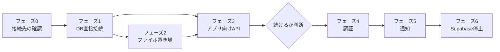

# Supabase 依存をなくす計画

調査範囲: `web/`(Next.js)・`supabase/`・`.github/`・`store-app/`・`native-apps/ttech-admin/`・別リポジトリの `diary-app`(ひとこと日記)

作成: 2026-10-26 / 状態: **未着手(着手前の確認待ち)**

> [!CAUTION]
> **この計画を実行する人(AIエージェントを含む)へ**: 作業を始める前に、末尾の「着手前に決めておくべき事項」を必ず持ち主に確認し、了承を得ること。確認が済むまで、コードの変更を始めないこと。

> [!IMPORTANT]
> いまの Supabase は、クラウドではなく自前のサーバーで動かしています。この計画は「自前の Supabase 一式(Kong・Auth・PostgREST・Storage など)をやめ、素の PostgreSQL と Web(Next.js)だけで動かす」ためのものです。APK の置き場(Cloudflare R2)は Supabase ではないので、この計画には含めません。

---

## なぜやるのか

- Supabase は、DB のほかに認証・API・ファイル置き場など10前後のコンテナで動いており、小さなサーバーには重く、更新や障害の切り分けの手間も大きい。
- 認証(JWT の形式・`auth` スキーマ)と権限(RLS)が Supabase の作りに深く依存しているため、Supabase 側の仕様変更の影響をそのまま受ける。
- アプリ(ストア・日記・管理)が Supabase の API を直接呼んでいるため、接続先を変えるたびにアプリの出し直しが必要になる(2026-10 の移行で実際に起きた)。

一方で、**認証の作り直しは規模が大きく、セキュリティ上の誤りが許されない**作業です。そのため、利用者への影響が小さいところから順に進め、認証を置き換える前(フェーズ4の前)に一度止まって、続けるかを判断する構成にしています。

---

## 現状: Supabase のどの機能をどこで使っているか

| 機能 | 使っている所 | 規模 |
|---|---|---|
| **認証(Auth)** | Web: メール+パスワード、Google ログイン(OAuth)、新規登録、TOTP の2段階認証(登録・確認・`aal` の判定)、管理者によるユーザー操作(取得・BAN・削除) | `auth.*` の呼び出し 約30か所 |
| | ストアアプリ: パスワード、Google(IDトークン+nonce)、トークン更新、2段階認証 | [SupabaseAuthApi.kt](../store-app/app/src/main/java/com/kawamonn/store/auth/SupabaseAuthApi.kt) |
| | 管理アプリ: パスワード、トークン更新、2段階認証 | [AuthApi.kt](../native-apps/ttech-admin/src/main/java/com/ttech/admin/data/AuthApi.kt) |
| | 日記アプリ: 新規登録、パスワード、Google、トークン更新、ログアウト | diary-app の `SupabaseAuthApi.kt` |
| | DB: `auth.uid()` 73か所、`auth.users` 7か所(新規ユーザーのトリガー、`admin_list_users`)、`is_admin()` の `auth.mfa_factors` と `auth.jwt()` | `supabase/migrations/` |
| **API(PostgREST)と RLS** | Web: `.from()` によるテーブル操作 約110か所。権限別のクライアントは service_role 40か所 / ログイン中のユーザー 9か所 / 匿名 7か所 / ブラウザから直接 13か所 | [supabase.ts](../web/src/lib/supabase.ts)、[supabase-browser.ts](../web/src/lib/supabase-browser.ts) |
| | ストアアプリ: アカウント画面で `profiles`・`apps`・`app_releases` を直接読む | [PostgrestApi.kt](../store-app/app/src/main/java/com/kawamonn/store/data/api/PostgrestApi.kt)、`AccountScreen.kt` |
| | 日記アプリ: **すべてのデータ操作を直接行い、守りは RLS だけ**(`diary_entries`・`diary_friendships`・`diary_blocks`・`diary_public_profiles`、RPC の `diary_block_user`・`diary_report_entry`・`diary_delete_my_account` など) | diary-app の `PostgrestApi.kt` |
| | DB: RLS ポリシー61個、`security definer` の関数19個、ロール `anon`・`authenticated`・`service_role` | `supabase/migrations/` |
| **ファイル置き場(Storage)** | `app-media`(公開。アイコン・スクリーンショット。管理画面はブラウザから直接アップロード)、`diary-media`(非公開。署名付きURL)。`storage.objects` のポリシー 15か所 | [MediaManager.tsx](../web/src/app/admin/(console)/apps/[id]/MediaManager.tsx)、`api/developer/apps/[id]/media`、[admin-queries.ts](../web/src/lib/admin-queries.ts)、[moderation.ts](../web/src/lib/moderation.ts)、diary-app の `StorageApi.kt` |
| **pg_net** | 通報・開発者登録の通知トリガー → Web の `/api/internal/notify` へ HTTP で送る | [20260925000000_admin.sql](../supabase/migrations/20260925000000_admin.sql) |
| **開発・CI** | `supabase start` / `supabase test db`(pgTAP)、`supabase/config.toml`、`@supabase/ssr`・`@supabase/supabase-js`、テスト用の `fake-supabase.ts` | [ci.yml](../.github/workflows/ci.yml) |

---

## フェーズ0: 先に確かめること(調査中に見つかった点)

| # | 内容 | 場所 | 影響 |
|---|---|---|---|
| 0-1 | **管理アプリの既定の接続先が、以前のクラウドの Supabase のまま**。ストアアプリは 2026-10-25 に直した(`1ab38f7`)が、管理アプリは未対応。ログインはクラウド、API 呼び出しは `store.kawamonn.com` に向いており、`1ab38f7` のとおりなら Web の API がトークンを受け付けない | [ttech-admin/build.gradle.kts:22](../native-apps/ttech-admin/build.gradle.kts#L22) | 管理アプリで操作できない可能性 |
| 0-2 | **日記アプリの既定の接続先も、以前のクラウドの Supabase のまま** | diary-app の `app/build.gradle.kts` | 配布中の日記アプリがクラウドを向いているなら、日記のデータはクラウド側で増え続けており、自前の DB と Web の管理画面(日記の通報対応)は移行時点の古いデータを見ている |

→ 配布中の各アプリ(ストア・管理・日記)がどこに接続しているかを確かめ、日記のデータの正本がどちらにあるかを確定させてから、この計画に入ります。クラウドの Supabase は、どのアプリからも使われていないと分かるまで消さないこと。

---

## フェーズ1: Web の DB アクセスを PostgreSQL への直接接続にする

利用者から見た変化がないところから始めます。ログインはまだ Supabase Auth のままです。

- Web から PostgreSQL に直接つなぎ、`.from()` の約110か所を SQL クライアント(D-3)に置き換える。
- **RLS は残す**(D-2)。`auth.uid()` を「接続ごとに Web が設定した値(`current_setting`)を返す関数」に置き換えれば、61個のポリシーはそのまま使える。Web は「そのリクエストのユーザーID」をトランザクションごとに設定してから SQL を実行する。
  - service_role で RLS を素通りしている40か所は、RLS をかけないロールの接続にまとめ、どこで使っているかを一覧できるようにする。
- ログイン中のユーザーの確認は、Supabase の JWT を Web 側で検証する形にする(Auth への問い合わせをやめる)。
- テスト用の `fake-supabase.ts` は、テスト用の PostgreSQL(コンテナ)を使う形に置き換える。

> [!NOTE]
> [リファクタリング計画](refactoring-plan.md)のフェーズ1(Web)と同じファイルを触ります。重複処理の共通化を先に済ませると、置き換える箇所が減ります(D-9)。

## フェーズ2: ファイル置き場を Supabase Storage から移す

- `app-media`(公開)と `diary-media`(非公開)の置き場を D-5 で決めた先に移し、既存のファイルを複製する。
- 公開ファイルの URL は `mediaUrl()`([dto.ts](../web/src/lib/dto.ts))にまとまっているので、そこを差し替える。DB の `icon_path` などはパスのまま持っているので、書き換えは不要の見込み。
- 管理画面のブラウザからの直接アップロードは、開発者側と同じ「サーバー経由」の処理に揃える(リファクタリング計画の 1-1 と同じ方向)。
- 日記の写真は、日記アプリがまだ Storage を直接使うので、フェーズ3で新しい API ができるまで**両方の置き場を見る**形にする。

## フェーズ3: アプリが Supabase を直接呼ばないようにする

- Web に、アプリ向けの API を足す。
  - ストアアプリのアカウント画面用(いま `profiles`・`apps`・`app_releases` を直接読んでいる分)
  - 日記アプリ用(投稿・友だち・ブロック・通報・写真・アカウント削除。いま RLS だけで守っている処理を、サーバー側の認可で守る)
- この時点では、ログインのトークンはまだ Supabase Auth のもの。Web が検証して受け付ける。
- ストアアプリ・日記アプリの新しい版を出す。**古い版は Supabase を直接呼び続ける**ので、移行期間中は Supabase を止めない(D-6)。
- 通知(pg_net)は、通報などの書き込みがすべて Web を通るようになったら、Web の処理の中で送る形に移せる(フェーズ5)。

---

> [!WARNING]
> **ここで一度止まって判断する。** フェーズ1〜3が終わると、Supabase で残るのは「認証」と「古いアプリのための API」だけになります。フェーズ4は規模とリスクが最も大きいので、続けるか、この状態で運用するかを決めてから進めます。

## フェーズ4: 認証を Web に移す

| 移すもの | いまの置き場所 | 移し方 |
|---|---|---|
| ユーザーID | `auth.users.id` | **同じ UUID を使う**(全テーブルが `profiles.id` = このIDを参照しているため) |
| パスワード | `auth.users.encrypted_password`(bcrypt) | ハッシュのまま移し、新しい仕組みで bcrypt として検証する(利用者のパスワード再設定は不要) |
| Google ログイン | `auth.identities`(Google のユーザーID) | 対応表を移す。Web は OAuth、アプリは IDトークン+nonce の検証を Web で行う |
| 2段階認証(TOTP) | `auth.mfa_factors` | D-8。秘密鍵が暗号化されているかで移せるかが変わる |
| BAN・削除 | `auth.admin.*` | 新しい仕組みの管理機能に置き換える |
| セッション | Cookie(Web)/ アクセス・リフレッシュトークン(アプリ) | 新しい形式で発行する。切り替え時の扱いは D-7 |

- 実装は D-4 で決めた方式で行う。`is_admin()` の `aal`(2段階認証済みか)の判定は、新しいセッションの情報から渡す形にする。
- 切り替えの間は、**古い Supabase のトークンも受け付ける**(古い版のアプリのため)。期限は D-6 に合わせる。
- 3つのアプリ(ストア・管理・日記)のログイン処理を、新しい Web の API に向けた版にして出し直す。

## フェーズ5: 通知を Web の処理に移す

- `private.notify_admin` と3つのトリガー(`net.http_post` を使っている)を、Web の API の中で通知を送る形に置き換え、`pg_net` を外す。
- 使われていない開発者申請の通知(リファクタリング計画の 1-6)は、ここで一緒に削除する。

## フェーズ6: Supabase を止める

- 移行期間(D-6)が過ぎ、古い版のアプリからのアクセスがないことを確かめてから、Supabase のコンテナ(Kong・Auth・PostgREST・Storage・Realtime・Studio など)を止め、素の PostgreSQL だけにする。
- `auth`・`storage` スキーマのうち参照が残っていないものを削除するマイグレーションを足す。
- CI の DB ジョブを、`supabase start` から PostgreSQL のサービスコンテナ+pgTAP に置き換える。
- `@supabase/ssr`・`@supabase/supabase-js`・`supabase/config.toml` を削除し、手順書(`setup.md`・`supabase-migration.md`・`admin.md`)と README を直す。
- クラウドの Supabase のプロジェクトは、フェーズ0で「どこからも使われていない」と確かめてあれば、ここで削除する。

---

## 進め方とおすすめの順番

| フェーズ | 規模 | リスク | 確認方法 |
|---|---|---|---|
| 0 | 小 | 低 | 配布中の各アプリの接続先と、日記のデータがどちらで増えているかを確認 |
| 1 | 大(約110か所) | 中(権限の抜け) | `npm test` / `typecheck` / `build`。**RLS のテスト(pgTAP)を、新しい「現在のユーザー」の渡し方で通す**。匿名・一般ユーザー・開発者・管理者で、見えてはいけないデータが見えないことを確認 |
| 2 | 中 | 中(画像の表示切れ) | 全アプリのアイコン・スクリーンショットの URL が表示できること、日記の写真が本人と友だちにだけ見えること |
| 3 | 大(API の追加+アプリ2つ) | 中〜高(日記の権限) | 日記の API に、他人の投稿・ブロック中の相手・BAN 中のユーザーのテストを足す。新旧両方の版のアプリで動くことを確認 |
| 4 | 大 | **高**(ログイン全般) | 既存ユーザーがパスワード・Google の両方でログインできること、管理者の2段階認証、BAN・アカウント削除、古いトークンの受け付けと期限切れ |
| 5 | 小 | 低 | 通報・開発者登録で運営にメールが届くこと |
| 6 | 中 | 中(古いアプリ) | 停止前にアクセスログで古い API への呼び出しがないこと。停止後に CI と本番の動作確認 |

> [!WARNING]
> - 公開リポジトリなので、**権限(RLS・認可)に関わる変更は、本番に適用して確かめてから push する**([supabase-migration.md](supabase-migration.md) の原則と同じ)。
> - フェーズ4でユーザーIDが変わると、全テーブルの持ち主の情報が壊れます。移行の前後で、ユーザー数と各テーブルの `user_id` の参照がすべて残っていることを数で確かめてください。
> - 各フェーズの前に DB とファイル置き場のバックアップを取り、戻し方を確認しておくこと。

---

## 着手前に決めておくべき事項

> [!IMPORTANT]
> この計画の実行を頼まれたら、作業を始める前に、下の表の「決定」が空欄の項目を持ち主に確認すること。
> 決まった内容は「決定」の列に日付つきで書き込んでから作業を始める。

| # | 決めること | 選択肢(おすすめは太字) | 決定 |
|---|---|---|---|
| D-1 | どこまでやるか | **この計画のとおり段階的に進め、フェーズ4の前に続けるかを決める** / 自前の Supabase は残し、使っていないサービス(Realtime・Studio など)を止めて軽くするだけ / 日記アプリの API 化(フェーズ3)だけ | |
| D-2 | 権限の守り方 | **RLS を残し、`auth.uid()` を Web が設定した値を返す関数に置き換える** / RLS をやめて、Web の処理の中だけで判定する | |
| D-3 | Web から DB を操作する道具 | **Kysely(SQL に近い書き方で型がつく)** / Drizzle / postgres.js で SQL を直接書く | |
| D-4 | 認証の実装 | **既存のライブラリ(Better Auth など。パスワード・Google・TOTP・アプリ用トークンがそろっているもの)** / 自前で実装する | |
| D-5 | ファイルの置き場 | **Cloudflare R2(APK ですでに使っている)** / サーバーのディスク | |
| D-6 | 古い版のアプリへの対応 | **移行期間(例: 2か月)は Supabase も動かしたままにし、アプリで新しい版への更新を促す** / 決めた日に打ち切る | |
| D-7 | 認証の切り替え時のログイン状態 | **全員に一度ログインし直してもらう** / Supabase のリフレッシュトークンを引き継ぐ | |
| D-8 | 2段階認証(TOTP)の移行 | **使っている人(管理者)が設定し直す** / 秘密鍵を移す(暗号化されていなければ) | |
| D-9 | リファクタリング計画との順番 | **リファクタリング計画のフェーズ0・1(Web)を先に済ませてから、この計画のフェーズ1に入る** / この計画を先にする | |
| D-10 | 作業単位 | **フェーズごとにブランチを切り、項目ごとにコミット** / main に直接コミット | |
