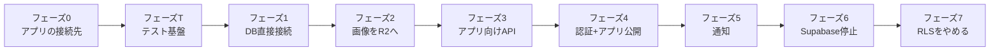

# Supabase 依存をなくす計画

調査範囲: `web/`(Next.js)・`supabase/`・`.github/`・`store-app/`・`native-apps/ttech-admin/`・別リポジトリの `diary-app`(ひとこと日記)

作成: 2026-10-26 / 状態: **未着手**。フェーズ0の調査のみ済み(2026-10-26)。決定事項は D-1〜D-8 が決定済み、D-9・D-10 が持ち主の確認待ち

> [!CAUTION]
> **この計画を実行する人(AIエージェントを含む)へ**: 実行の手順は [supabase-removal/README.md](supabase-removal/README.md) から始まる手順書にある。最初に README を読み、そのルールに従うこと。末尾の「着手前に決めておくべき事項」の「決定」に**空欄か「確認待ち」があれば、持ち主に確認してから**始めること。

> [!IMPORTANT]
> いまの Supabase は、クラウドではなく自前のサーバーで動かしています。この計画は「自前の Supabase 一式(Kong・Auth・PostgREST・Storage など)をやめ、素の PostgreSQL と Web(Next.js)だけで動かす」ためのものです。APK の置き場(Cloudflare R2)は Supabase ではないので、この計画には含めません。

---

## なぜやるのか

- Supabase は、DB のほかに認証・API・ファイル置き場など10前後のコンテナで動いており、小さなサーバーには重く、更新や障害の切り分けの手間も大きい。
- 認証(JWT の形式・`auth` スキーマ)と権限(RLS)が Supabase の作りに深く依存しているため、Supabase 側の仕様変更の影響をそのまま受ける。
- アプリ(ストア・日記・管理)が Supabase の API を直接呼んでいるため、接続先を変えるたびにアプリの出し直しが必要になる(2026-10 の移行で実際に起きた)。

一方で、**認証の作り直しは規模が大きく、セキュリティ上の誤りが許されない**作業です。そのため、
- 利用者への影響が小さいところから順に進めます。
- 最初に「外から見た動き」を記録するテスト(フェーズT)を作り、以降のすべてのフェーズで、そのテストが変更なしで通ることを本番に出す条件にします。
- 本番に触れる操作の前には必ずバックアップを取り、直後に本番のスモークテストを流し、失敗したらすぐ戻します。

持ち主の方針(2026-10-26)は「テストを整えたうえで、本番の操作も含めて AI エージェントに任せる」です。上の3つは、そのための安全装置です。

---

## 現状: Supabase のどの機能をどこで使っているか

| 機能 | 使っている所 | 規模 |
|---|---|---|
| **認証(Auth)** | Web: メール+パスワード、Google ログイン(OAuth)、新規登録、TOTP の2段階認証(登録・確認・`aal` の判定)、管理者によるユーザー操作(取得・BAN・削除) | `auth.*` の呼び出し 約30か所 |
| | ストアアプリ: パスワード、Google(IDトークン+nonce)、トークン更新、2段階認証 | [SupabaseAuthApi.kt](../store-app/app/src/main/java/com/kawamonn/store/auth/SupabaseAuthApi.kt) |
| | 管理アプリ: パスワード、トークン更新、2段階認証 | [AuthApi.kt](../native-apps/ttech-admin/src/main/java/com/ttech/admin/data/AuthApi.kt) |
| | 日記アプリ: 新規登録、パスワード、Google、トークン更新、ログアウト | diary-app の `SupabaseAuthApi.kt` |
| | DB: `auth.uid()` 73か所、`auth.users` 7か所(新規ユーザーのトリガー、`admin_list_users`)、`is_admin()` の `auth.mfa_factors` と `auth.jwt()` | `supabase/migrations/` |
| **API(PostgREST)と RLS** | Web: `.from()` によるテーブル操作 約110か所。権限別のクライアントは service_role 40か所 / ログイン中のユーザー 9か所 / 匿名 7か所 / ブラウザから直接 13か所 | [supabase.ts](../web/src/lib/supabase.ts)、[supabase-browser.ts](../web/src/lib/supabase-browser.ts) |
| | ストアアプリ: アカウント画面で `profiles`・`apps`・`app_releases` を直接読む | [PostgrestApi.kt](../store-app/app/src/main/java/com/kawamonn/store/data/api/PostgrestApi.kt)、`AccountScreen.kt` |
| | 日記アプリ: **すべてのデータ操作を直接行い、守りは RLS だけ**(`diary_entries`・`diary_friendships`・`diary_blocks`・`diary_public_profiles`、RPC の `diary_block_user`・`diary_report_entry`・`diary_delete_my_account` など) | diary-app の `PostgrestApi.kt` |
| | DB: RLS ポリシー61個、`security definer` の関数19個、ロール `anon`・`authenticated`・`service_role` | `supabase/migrations/` |
| **ファイル置き場(Storage)** | `app-media`(公開。アイコン・スクリーンショット。管理画面はブラウザから直接アップロード)、`diary-media`(非公開。署名付きURL)。`storage.objects` のポリシー 15か所 | [MediaManager.tsx](../web/src/app/admin/(console)/apps/[id]/MediaManager.tsx)、`api/developer/apps/[id]/media`、[admin-queries.ts](../web/src/lib/admin-queries.ts)、[moderation.ts](../web/src/lib/moderation.ts)、diary-app の `StorageApi.kt` |
| **pg_net** | 通報・開発者登録の通知トリガー → Web の `/api/internal/notify` へ HTTP で送る | [20260925000000_admin.sql](../supabase/migrations/20260925000000_admin.sql) |
| **開発・CI** | `supabase start` / `supabase test db`(pgTAP)、`supabase/config.toml`、`@supabase/ssr`・`@supabase/supabase-js`、テスト用の `fake-supabase.ts` | [ci.yml](../.github/workflows/ci.yml) |

---

## フェーズ0: 先に確かめること(調査中に見つかった点)

| # | 内容 | 場所 | 影響 |
|---|---|---|---|
| 0-1 | **管理アプリの既定の接続先が、以前のクラウドの Supabase のまま**。ストアアプリは 2026-10-25 に直した(`1ab38f7`)が、管理アプリは未対応。ログインはクラウド、API 呼び出しは `store.kawamonn.com` に向いており、`1ab38f7` のとおりなら Web の API がトークンを受け付けない | [ttech-admin/build.gradle.kts:22](../native-apps/ttech-admin/build.gradle.kts#L22) | 管理アプリで操作できない可能性 |
| 0-2 | **日記アプリの既定の接続先も、以前のクラウドの Supabase のまま** | diary-app の `app/build.gradle.kts` | 配布中の日記アプリがクラウドを向いているなら、日記のデータはクラウド側で増え続けており、自前の DB と Web の管理画面(日記の通報対応)は移行時点の古いデータを見ている |

→ 配布中の各アプリ(ストア・管理・日記)がどこに接続しているかを確かめ、日記のデータの正本がどちらにあるかを確定させてから、この計画に入ります。クラウドの Supabase は、どのアプリからも使われていないと分かるまで消さないこと。

**調査結果(2026-10-26)**

- 配布中の最新版(管理アプリ 1.0.2、日記アプリ 1.1.2)は、APK の SHA-256 が手元のリリースビルドと一致し、どちらにもクラウドの Supabase の URL が埋め込まれている。**0-1・0-2 とも、配布中のアプリはクラウドを向いている。**
- クラウド側の認証の利用(ログイン・トークン更新)は 2026-10-06 が最後で、それ以降はない。日記の投稿はクラウドに1件もない。→ 日記のデータの食い違いは起きておらず、移すべきデータもない。
- `1ab38f7` の説明のとおり、クラウドでログインして得たトークンは Web の API が受け付けないので、管理アプリはいまログインしても操作できないとみられる(実機では未確認)。
- 対処: 両アプリの既定の接続先を `store.kawamonn.com` に変えた版を出す(`1ab38f7` と同じ修正)。日記アプリは、この計画のフェーズ3で Web の API に移すときにまとめて出し直してもよい。

---

## フェーズT: テスト基盤を作る(詳細: [supabase-removal/phaseT-tests.md](supabase-removal/phaseT-tests.md))

- 手元に本番と同じ構成の検証環境(ローカルの Supabase・偽の R2・Web)を作る。
- 全 API × 全ロール(未ログイン・一般・BAN 中・開発者・他の開発者・管理者・2段階認証の前後)の HTTP ステータスの表、応答の形のスナップショット、業務の流れ、日記の公開範囲のシナリオを、**今の実装の動きのまま**記録する。
- ログインの方法と日記の呼び方は差し替えられる「ドライバー」にして、以降のフェーズでも同じテストを使い回す。
- 本番のスモークテスト(専用のアカウントで、利用者と同じ権限だけを使う)と、バックアップ・SQL の適用・デプロイ・戻し方の運用スクリプトを作る。

## フェーズ1: Web の DB アクセスを PostgreSQL への直接接続にする

利用者から見た変化がないところから始めます。ログインはまだ Supabase Auth のままです。

- Web から PostgreSQL に直接つなぎ、`.from()` の約110か所を SQL クライアント(D-3)に置き換える。
- **RLS は残す**(D-2)。`auth.uid()` を「接続ごとに Web が設定した値(`current_setting`)を返す関数」に置き換えれば、61個のポリシーはそのまま使える。Web は「そのリクエストのユーザーID」をトランザクションごとに設定してから SQL を実行する。
  - service_role で RLS を素通りしている40か所は、RLS をかけないロールの接続にまとめ、どこで使っているかを一覧できるようにする。
- ログイン中のユーザーの確認は、Supabase の JWT を Web 側で検証する形にする(Auth への問い合わせをやめる)。
- テスト用の `fake-supabase.ts` は、テスト用の PostgreSQL(コンテナ)を使う形に置き換える。

> [!NOTE]
> [リファクタリング計画](refactoring-plan.md)のフェーズ1(Web)と同じファイルを触ります。重複処理の共通化を先に済ませると、置き換える箇所が減ります(D-9)。

## フェーズ2: ファイル置き場を Supabase Storage から移す

- `app-media`(公開)と `diary-media`(非公開)の置き場を D-5 で決めた先に移し、既存のファイルを複製する。
- 公開ファイルの URL は `mediaUrl()`([dto.ts](../web/src/lib/dto.ts))にまとまっているので、そこを差し替える。DB の `icon_path` などはパスのまま持っているので、書き換えは不要の見込み。
- 管理画面のブラウザからの直接アップロードは、開発者側と同じ「サーバー経由」の処理に揃える(リファクタリング計画の 1-1 と同じ方向)。
- 日記の写真は、日記アプリがまだ Storage を直接使うので、フェーズ3で新しい API ができるまで**両方の置き場を見る**形にする。

## フェーズ3: アプリが Supabase を直接呼ばないようにする

- Web に、アプリ向けの API を足す。
  - ストアアプリのアカウント画面用(いま `profiles`・`apps`・`app_releases` を直接読んでいる分)
  - 日記アプリ用(投稿・友だち・ブロック・通報・写真・アカウント削除。いま RLS だけで守っている処理を、サーバー側の認可で守る)
- この時点では、ログインのトークンはまだ Supabase Auth のもの。Web が検証して受け付ける。
- アプリの新しい版は、ログインの変更(フェーズ4)と一緒に1回だけ出す(2回出し直さない)。
- 通知(pg_net)は、通報などの書き込みがすべて Web を通るようになったら、Web の処理の中で送る形に移せる(フェーズ5)。

---

## フェーズ4: 認証を Web に移す

| 移すもの | いまの置き場所 | 移し方 |
|---|---|---|
| ユーザーID | `auth.users.id` | **同じ UUID を使う**(全テーブルが `profiles.id` = このIDを参照しているため) |
| パスワード | `auth.users.encrypted_password`(bcrypt) | ハッシュのまま移し、新しい仕組みで bcrypt として検証する(利用者のパスワード再設定は不要) |
| Google ログイン | `auth.identities`(Google のユーザーID) | 対応表を移す。Web は OAuth、アプリは IDトークン+nonce の検証を Web で行う |
| 2段階認証(TOTP) | `auth.mfa_factors` | 移さない。管理者が設定し直す(D-8)。TOTP は Better Auth のプラグインではなく自前の表で扱い、今と同じ「同じセッションが aal1 → aal2 になる」しくみを保つ |
| BAN・削除 | `auth.admin.*` | 新しい仕組みの管理機能に置き換える |
| セッション | Cookie(Web)/ アクセス・リフレッシュトークン(アプリ) | 新しい形式で発行する。切り替え時の扱いは D-7 |

- 実装は D-4 で決めた方式で行う。`is_admin()` の `aal`(2段階認証済みか)の判定は、新しいセッションの情報から渡す形にする。
- アプリ向けに、Supabase Auth と同じ形(パス・本文・応答)のログインの API を Web に作る。3つのアプリ(ストア・管理・日記)は、呼び先の URL を変えるだけで済む。
- 新しい認証の表は、移行中も動いている PostgREST から読めないように、権限を外して RLS を有効にする(パスワードのハッシュが入るため)。
- 切り替えの間だけ古い Supabase のトークンも受け付け、アプリの新しい版を出したらすぐに止める(D-6)。

## フェーズ5: 通知を Web の処理に移す

- `private.notify_admin` と3つのトリガー(`net.http_post` を使っている)を、Web の API の中で通知を送る形に置き換え、`pg_net` を外す。
- 使われていない開発者申請の通知(リファクタリング計画の 1-6)は、ここで一緒に削除する。

## フェーズ6: Supabase を止める

- 先に Web から Supabase の名残(古いしくみへの戻り道・ライブラリ・設定)を消して出す。
- 本番の DB は、スキーマをリポジトリのマイグレーション(Supabase の全マイグレーションをまとめた baseline)から作り、データだけを今の DB から写した、素の PostgreSQL の新しいコンテナに移す。写す前に本番のスキーマと baseline が同じことを機械で確かめ、本番のダンプを使ったリハーサルを手元で先に通す。
- そのあと Supabase のコンテナ(Kong・Auth・PostgREST・Storage・Realtime・Studio など)を止める。消すのは2週間後。
- CI の DB ジョブを、`supabase start` から PostgreSQL のサービスコンテナ+pgTAP に置き換える。
- `@supabase/ssr`・`@supabase/supabase-js`・`supabase/config.toml` を削除し、手順書(`setup.md`・`supabase-migration.md`・`admin.md`)と README を直す。
- クラウドの Supabase のプロジェクトは、フェーズ0で「どこからも使われていない」と確かめてあれば、ここで削除する。

## フェーズ7: RLS をやめる(詳細: [supabase-removal/phase7-drop-rls.md](supabase-removal/phase7-drop-rls.md))

- RLS の各ポリシーを、Web のコードのどこでどう判定するかの対応表を作り、RLS を残したままコードにも同じ判定を書く(2重)。
- テストの DB だけ RLS を切って全テストが通ることを確かめてから、本番の RLS を切る(ポリシーは残し、すぐ戻せるようにする)。
- 1週間問題が無ければ、ポリシー・ロールの切り替え・`auth.uid()` の代わりの関数を消す。

---

## 進め方とおすすめの順番

詳しい手順は、フェーズごとの手順書([supabase-removal/](supabase-removal/README.md))にある。

| フェーズ | 手順書 | 規模 | リスク | 本番に出す条件(すべてのフェーズ共通: フェーズT のテストが変更なしで合格+直後のスモークテスト) |
|---|---|---|---|---|
| 0 | [phase0](supabase-removal/phase0-app-endpoints.md) | 小 | 低 | APK に埋め込まれた接続先が新しいサーバーだけであること |
| T | [phaseT](supabase-removal/phaseT-tests.md) | 大 | 低(本番は読むだけ+スモーク用アカウント) | API テストが3回続けて合格、CI が緑 |
| 1 | [phase1](supabase-removal/phase1-db.md) | 大(約110か所) | 中(権限の抜け) | 同じ行を PostgREST と直結の両方で読んで一致、スナップショットに差分なし |
| 2 | [phase2](supabase-removal/phase2-storage.md) | 中 | 中(画像の表示切れ) | スナップショットの差分が画像の URL だけ、公開中の全アプリの画像が 200 |
| 3 | [phase3](supabase-removal/phase3-app-api.md) | 大(API の追加+アプリ2つ) | 中〜高(日記の権限) | 日記のシナリオが、今の直接アクセスと新しい API の両方で同じ結果 |
| 4 | [phase4](supabase-removal/phase4-auth.md) | 大 | **高**(ログイン全般) | 全テストが Better Auth のログインで合格、移行のテストで既存ユーザーが同じパスワードでログインできる、認証の表が PostgREST から読めない |
| 5 | [phase5](supabase-removal/phase5-notify.md) | 小 | 低 | 通報・開発者登録で通知が1通作られる |
| 6 | [phase6](supabase-removal/phase6-shutdown.md) | 中〜大 | 中(短い停止時間) | 本番と baseline のスキーマが一致、本番のダンプでのリハーサルが合格、移行後の行数が一致 |
| 7 | [phase7](supabase-removal/phase7-drop-rls.md) | 中 | 中(守りが1重になる) | RLS を切ったテストの DB で全テストが合格 |

> [!WARNING]
> - 公開リポジトリなので、**権限(RLS・認可)に関わる変更は、本番に適用して確かめてから push する**([supabase-migration.md](supabase-migration.md) の原則と同じ)。
> - フェーズ4でユーザーIDが変わると、全テーブルの持ち主の情報が壊れます。移行の前後で、ユーザー数と各テーブルの `user_id` の参照がすべて残っていることを数で確かめてください。
> - 各フェーズの前に DB とファイル置き場のバックアップを取り、戻し方を確認しておくこと。

---

## 着手前に決めておくべき事項

> [!IMPORTANT]
> この計画の実行を頼まれたら、作業を始める前に、下の表の「決定」が空欄の項目を持ち主に確認すること。
> 決まった内容は「決定」の列に日付つきで書き込んでから作業を始める。

| # | 決めること | 選択肢(おすすめは太字) | 決定 |
|---|---|---|---|
| D-1 | どこまでやるか | **この計画のとおり段階的に進め、フェーズ4の前に続けるかを決める** / 自前の Supabase は残し、使っていないサービス(Realtime・Studio など)を止めて軽くするだけ / 日記アプリの API 化(フェーズ3)だけ | 2026-10-26: **全部行う**(途中で止まって判断はしない。判断の代わりに、各フェーズの機械の合格条件で止める) |
| D-2 | 権限の守り方 | **RLS を残し、`auth.uid()` を Web が設定した値を返す関数に置き換える** / RLS をやめて、Web の処理の中だけで判定する | 2026-10-26: **移行中は RLS を残し、最後に RLS もやめる**(フェーズ7を追加) |
| D-3 | Web から DB を操作する道具 | **Kysely(SQL に近い書き方で型がつく)** / Drizzle / postgres.js で SQL を直接書く | 2026-10-26: **Kysely** |
| D-4 | 認証の実装 | **既存のライブラリ(Better Auth など。パスワード・Google・TOTP・アプリ用トークンがそろっているもの)** / 自前で実装する | 2026-10-26: **Better Auth**(TOTP は今のしくみを保つため自前の表で扱う。フェーズ4の手順書を参照) |
| D-5 | ファイルの置き場 | **Cloudflare R2(APK ですでに使っている)** / サーバーのディスク | 2026-10-26: **Cloudflare R2**(公開せず、Web のルートから配る) |
| D-6 | 古い版のアプリへの対応 | **移行期間(例: 2か月)は Supabase も動かしたままにし、アプリで新しい版への更新を促す** / 決めた日に打ち切る | 2026-10-26: **新しい版を出したらすぐ止める** |
| D-7 | 認証の切り替え時のログイン状態 | **全員に一度ログインし直してもらう** / Supabase のリフレッシュトークンを引き継ぐ | 2026-10-26: **全員にログインし直してもらう** |
| D-8 | 2段階認証(TOTP)の移行 | **使っている人(管理者)が設定し直す** / 秘密鍵を移す(暗号化されていなければ) | 2026-10-26: **設定し直す** |
| D-9 | リファクタリング計画との順番 | リファクタリング計画のフェーズ0・1(Web)を先に済ませてから、この計画のフェーズ1に入る / **この計画を先にする**(リファクタリング計画の残りは、この計画で多くの箇所が書き換わった後に見直す。2つの計画を混ぜると、実行するエージェントの手順が複雑になるため) | 2026-10-26 提案: この計画を先にする(**持ち主の確認待ち**) |
| D-10 | 作業単位 | **フェーズごとにブランチを切り、項目ごとにコミット** / main に直接コミット | 2026-10-26 提案: フェーズごとにブランチ、ステップごとにコミット(フェーズ0だけ main に直接)(**持ち主の確認待ち**) |
| D-11 | 本番の操作を誰が行うか | **テストを整えたうえで、エージェントが行う** / 持ち主が承認してから / 持ち主が行う | 2026-10-26: **テストを徹底的に整え、エージェントに全部任せる**。安全装置は [supabase-removal/README.md](supabase-removal/README.md) の「本番に触れる操作」 |
| D-12 | エージェントが作業する場所 | **Windows の PowerShell** / WSL の bash | 2026-10-26: **Windows の PowerShell** |
